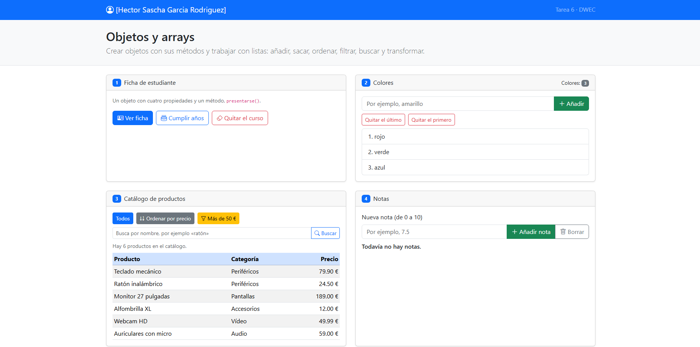
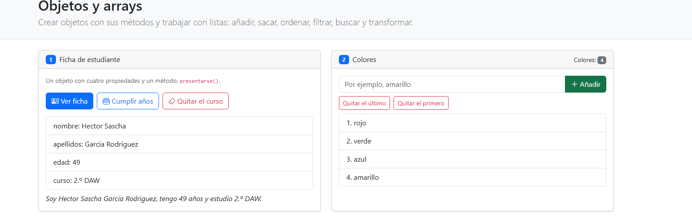
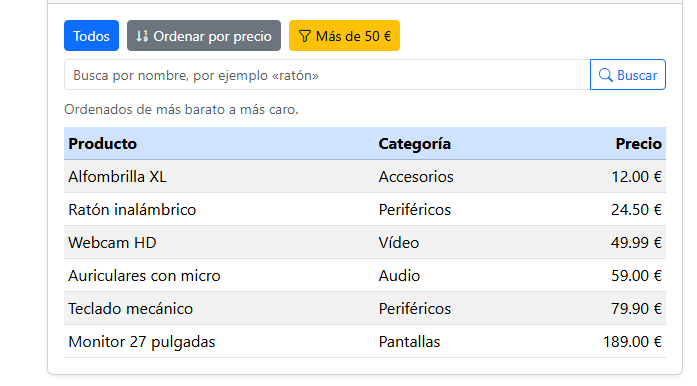
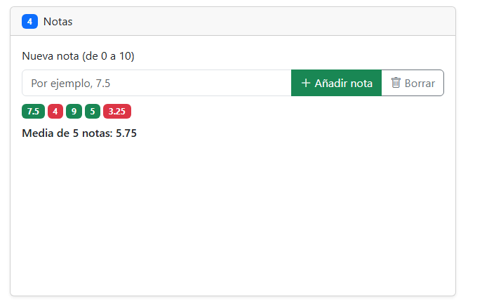

# Tarea 6 · Objetos y arrays

**Autor:** Hector Sascha Garcia Rodriguez · Desarrollo Web en Entorno Cliente (DWEC) · 2.º DAW · Curso 2026-27

En esta carpeta está la página «Objetos y arrays», con seis ejercicios, uno por tarjeta. Los datos y las funciones están en `js/app.js`. Para probarla basta abrir la carpeta en VS Code, pulsar **Go Live** y usar los botones con la consola abierta (F12), donde cada función deja su rastro. Los resultados se pintan con `createElement`, `textContent`, `classList` y `append`, sin `innerHTML` y sin funciones flecha.

## Capturas

### a) La página recién cargada

Nada más cargar se ve mi nombre en la navbar, los tres colores de partida, la tabla con los seis productos y las ocho ciudades con su posición.

### b) Ejercicios 1 y 2: la ficha y los colores

La ficha, después de pulsar «Cumplir años», con la edad subida en uno, y la frase de `presentarse()` debajo. En los colores he añadido uno con `push` y he quitado otro con `pop`. Si borro el curso con `delete`, la ficha muestra `undefined`, porque esa propiedad ya no existe en el objeto y leer algo que no existe devuelve `undefined`.

### c) Ejercicio 3: el catálogo ordenado por precio

La tabla ordenada de más barato a más caro con `sort` y la función de comparación `a.precio - b.precio`. Ordeno una copia (`[...productos]`) porque `sort` modifica el array sobre el que se llama.

### d) Ejercicio 4: las notas y la media

Cinco notas (7.5, 4, 9, 5 y 3.25): las de 5 o más salen en verde y las suspensas en rojo. La media, calculada con `reduce`, es 5.75.

### e) Ejercicio 5: los tres métodos seguidos

Primero `filter` se queda con los pares (2, 4, 6, 8, 10), después `map` calcula sus dobles (4, 8, 12, 16, 20) y por último `reduce` los suma. El resultado final es 60.

### f) Ejercicio 6: después de splice y de buscar una ciudad

Tras `splice(2, 2)` han desaparecido Málaga y Córdoba y el array se ha quedado con seis ciudades. Al buscar Jaén, `includes` devuelve `true` e `indexOf` devuelve 2, cuando antes del `splice` estaba en la posición 4, porque `splice` recoloca las ciudades que quedan.

## Reflexión

Los métodos que cambian el array original son `push`, `pop`, `shift`, `splice` y `sort`. Los que devuelven uno nuevo son `slice`, `map` y `filter`, y `find`, `includes` e `indexOf` solo devuelven un dato. En el ejercicio 6 se ve bien la diferencia: `slice(2, 5)` devuelve tres ciudades y el array sigue con ocho, mientras que `splice(2, 2)` quita dos y el array se queda con seis. Por eso en el ejercicio 3 ordeno una copia: si ordenara `productos` directamente, el botón «Todos» dejaría de mostrar el catálogo en su orden original.

## Fuentes

- MDN, [Array](https://developer.mozilla.org/es/docs/Web/JavaScript/Reference/Global_Objects/Array)
- MDN, [sort](https://developer.mozilla.org/es/docs/Web/JavaScript/Reference/Global_Objects/Array/sort)
- MDN, [splice](https://developer.mozilla.org/es/docs/Web/JavaScript/Reference/Global_Objects/Array/splice)
- MDN, [slice](https://developer.mozilla.org/es/docs/Web/JavaScript/Reference/Global_Objects/Array/slice)
- MDN, [reduce](https://developer.mozilla.org/es/docs/Web/JavaScript/Reference/Global_Objects/Array/reduce)
- MDN, [delete](https://developer.mozilla.org/es/docs/Web/JavaScript/Reference/Operators/delete)

## Uso de IA

He usado Claude (asistente de IA de Anthropic) para organizar los commits, obtener ejemplos de código de cada ejercicio y preparar el borrador de este README. Después probé cada botón con la consola abierta, adapté el código a mis datos y hice yo las capturas en mi equipo.