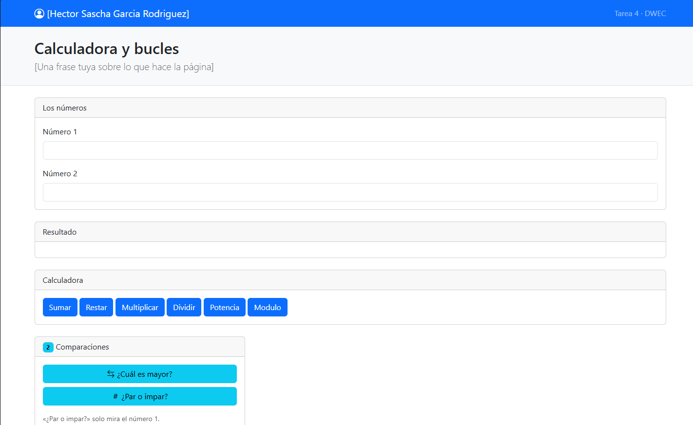
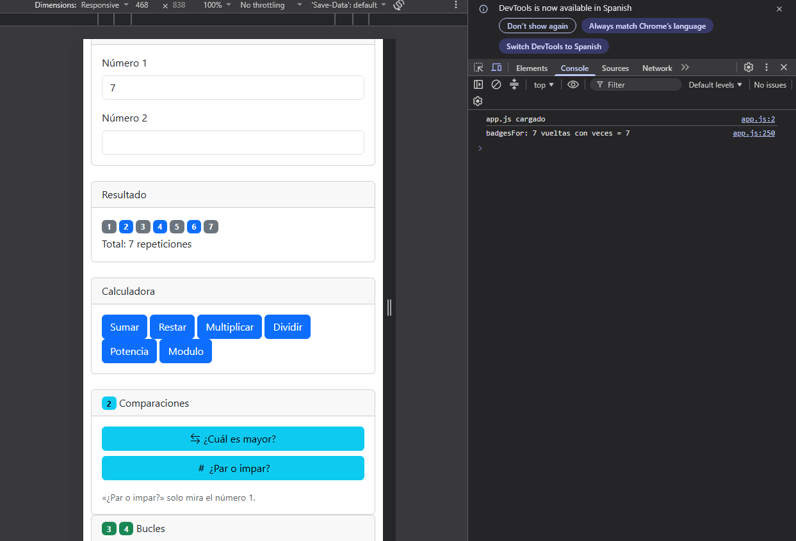
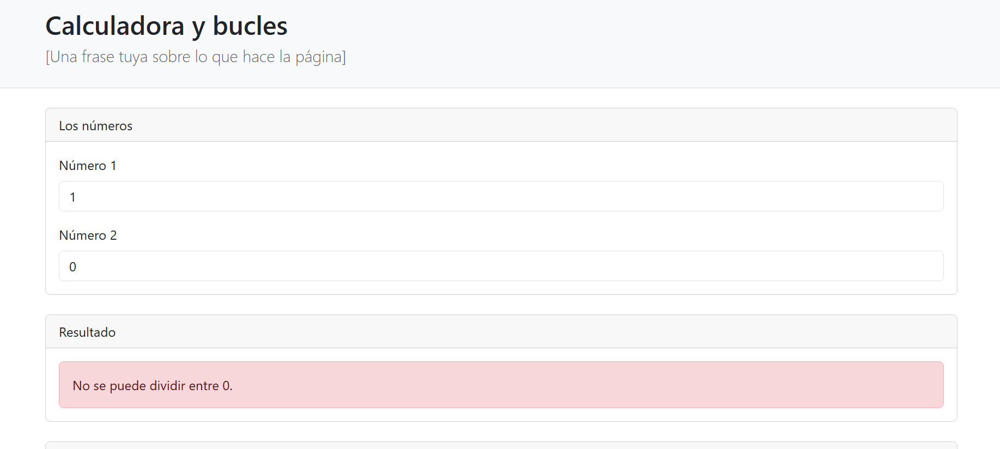
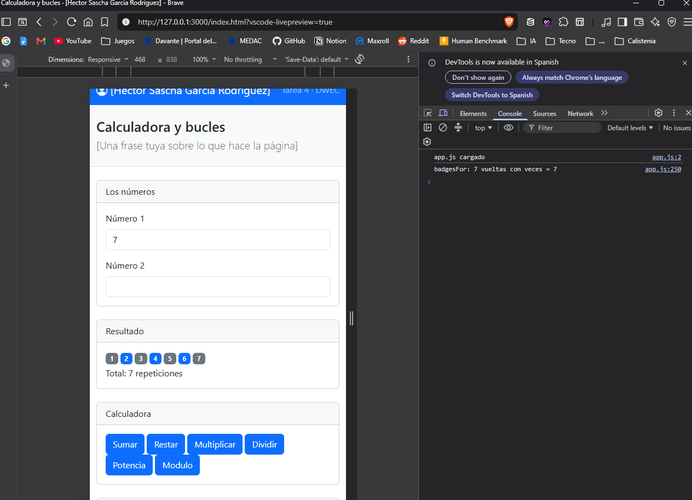

# Tarea 4 · Calculadora y bucles

**Alumno:** [Hector Sascha Garcia Rodriguez]
**Asignatura:** DWEC 26/27 · Tema 4

## Qué he hecho

He maquetado con Bootstrap una página con una card para los números, otra para el resultado y una por ejercicio. Todas están dentro de la rejilla (`row` y `col-*`), así que en el móvil van una debajo de otra y en pantalla grande se reparten en columnas.

- **Calculadora:** las seis operaciones, con control de casillas vacías y de la división y el módulo entre 0.
- **Comparaciones:** «¿Cuál es mayor?» con `if`, `else if` y `else`, y «¿Par o impar?» con el ternario y aviso si el número tiene decimales.
- **Bucles con texto:** `for`, `while` y `do…while`, con contador, total en singular o plural y validación del número con `||`.
- **Bucles con badges:** los mismos tres bucles, con los pares y los impares de distinto color.

Cada función deja su rastro en la consola con `console.log()`.

## Capturas

### Página completa

### Vista en el móvil

### Dividir entre 0

### Bucles de texto con el 0

### Bucle con badges

## Reflexión

- `for` lo uso cuando sé cuántas vueltas hay, porque junta inicio, condición y paso en una línea.
- `while` lo uso cuando no sé cuántas vueltas habrá y depende de una condición.
- `do…while` comprueba la condición al final, así que siempre se ejecuta al menos una vez.
- Ejemplo con el 0: con 0, `for` y `while` no entraron ni una vez (Total: 0 repeticiones), pero `do…while` hizo una vuelta (Total: 1 repetición).
- Cuándo usaría do…while: cuando algo tiene que pasar sí o sí una vez, como pedir un dato y repetir si es incorrecto.

## Fuentes

- MDN, [for](https://developer.mozilla.org/es/docs/Web/JavaScript/Reference/Statements/for)
- MDN, [while](https://developer.mozilla.org/es/docs/Web/JavaScript/Reference/Statements/while)
- MDN, [do...while](https://developer.mozilla.org/es/docs/Web/JavaScript/Reference/Statements/do...while)
- MDN, [Operador condicional (ternario)](https://developer.mozilla.org/es/docs/Web/JavaScript/Reference/Operators/Conditional_operator)
- Bootstrap, [documentación](https://getbootstrap.com/docs/5.3/)

## Uso de IA

He usado Claude (asistente de IA) para organizar los commits de la tarea y para obtener ejemplos de código de cada ejercicio. También lo usé para preparar un borrador del README, que revisé y reescribí ciertas cosas.
