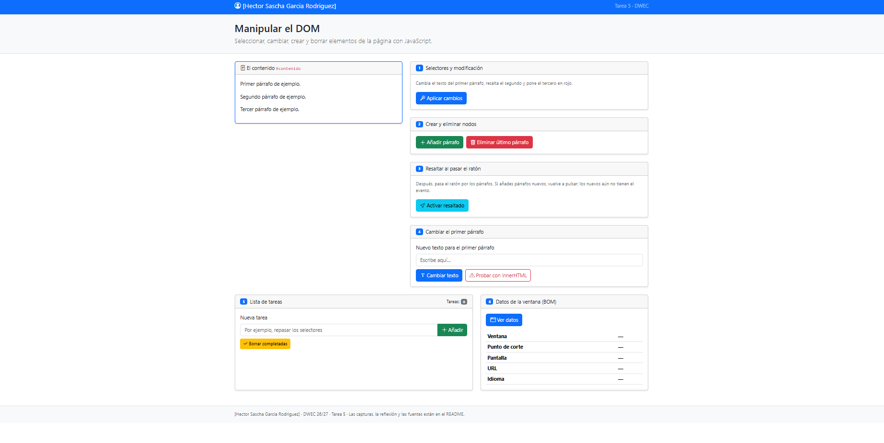
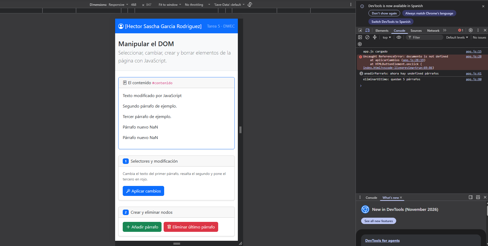
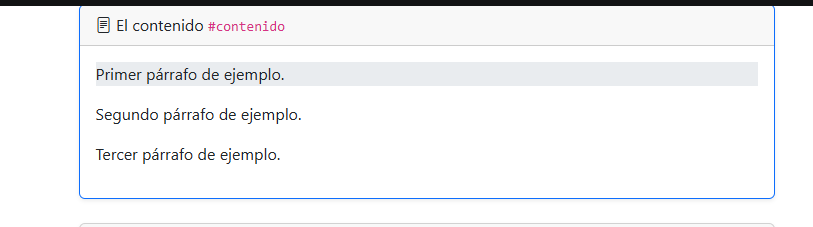
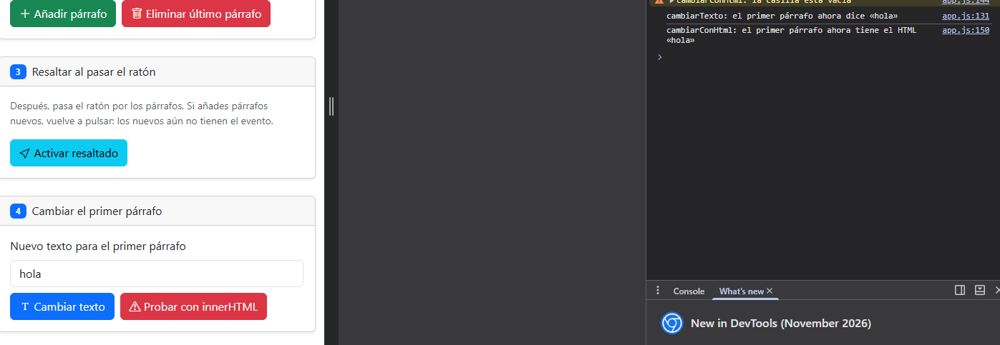
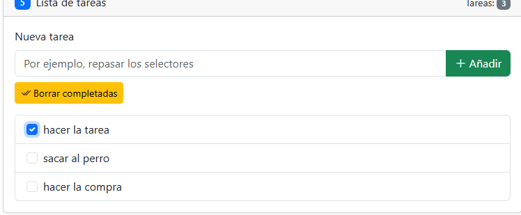
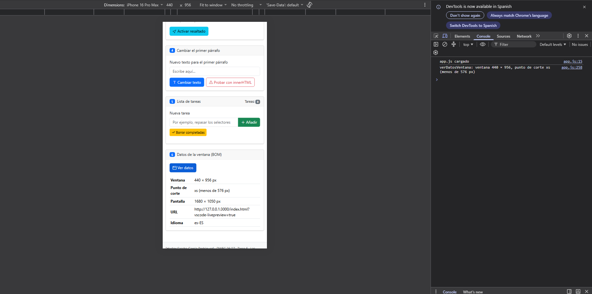

# Tarea 5 · Manipular el DOM

**Alumno:** [Tu nombre y apellidos]
**Asignatura:** DWEC 26/27 · Tema 5

## Qué he hecho

He completado en `js/app.js` las seis funciones de la página, una por botón. Cada una deja su rastro en la consola con `console.log()`.

- **Selectores y modificación:** cambio los tres párrafos con `getElementById`, `querySelector` y `querySelectorAll`, usando clases de Bootstrap.
- **Crear y eliminar nodos:** añado párrafos numerados con `createElement` y `append`, y borro el último con `remove()`. Si no queda ninguno, muestro un aviso.
- **Resaltar con el ratón:** `mouseenter` y `mouseleave` en cada párrafo.
- **Cambiar el primer párrafo:** con `textContent` y con `innerHTML`, comprobando que la casilla no esté vacía.
- **Lista de tareas:** añado tareas con su casilla, borro las marcadas y mantengo el contador.
- **Datos de la ventana:** tamaño de ventana y pantalla, URL, idioma y punto de corte de Bootstrap.

## Capturas

### Página recién cargada

[Una o dos líneas: qué se ve.]

### Ejercicios 1 y 2 aplicados

[Una o dos líneas: qué se ve.]

### Párrafo resaltado con el ratón

[Una o dos líneas: qué se ve y qué pasa con los párrafos nuevos.]

### innerHTML con <b>hola</b>

[Una o dos líneas: qué se ve.]

### Lista de tareas

[Una o dos líneas: qué se ve.]

### Datos de la ventana en modo móvil

[Una o dos líneas: qué se ve.]

## Reflexión

[ESCRÍBELA TÚ, de 5 a 8 líneas. Ideas de partida:
- `textContent` trata lo que le pasas como texto; `innerHTML` lo interpreta como HTML.
- Con `<b>hola</b>`: con `textContent` vi las etiquetas escritas; con `innerHTML` vi «hola» en negrita.
- Si el usuario escribe HTML o código en una casilla y se mete con `innerHTML`, ese código se ejecuta en la página (ataque XSS).
- Por eso con lo que escribe el usuario uso siempre `textContent`, como en la lista de tareas.
- Los párrafos nuevos no tienen los eventos porque `querySelectorAll` devuelve los que existían al pulsar; hay que volver a pulsar el botón.]

## Fuentes

- MDN, [textContent](https://developer.mozilla.org/es/docs/Web/API/Node/textContent)
- MDN, [innerHTML](https://developer.mozilla.org/es/docs/Web/API/Element/innerHTML)
- MDN, [querySelector](https://developer.mozilla.org/es/docs/Web/API/Document/querySelector)
- MDN, [createElement](https://developer.mozilla.org/es/docs/Web/API/Document/createElement)
- MDN, [addEventListener](https://developer.mozilla.org/es/docs/Web/API/EventTarget/addEventListener)
- Bootstrap, [puntos de corte](https://getbootstrap.com/docs/5.3/layout/breakpoints/)

## Uso de IA

**Herramienta:** Claude (asistente de IA de Anthropic).

**Para qué la usé:**
- Para organizar el trabajo en commits, uno por cada punto de los ejercicios.
- Para obtener ejemplos de código de las funciones de `app.js`.
- Para preparar un borrador del README y la lista de capturas.

**Qué hice después con sus respuestas:**
- [Escribí las funciones a partir de los ejemplos y probé cada botón con la consola abierta.]
- [Hice yo las seis capturas en mi equipo y escribí la reflexión con mis palabras.]
- [Corregí los errores que me salieron en la consola.]