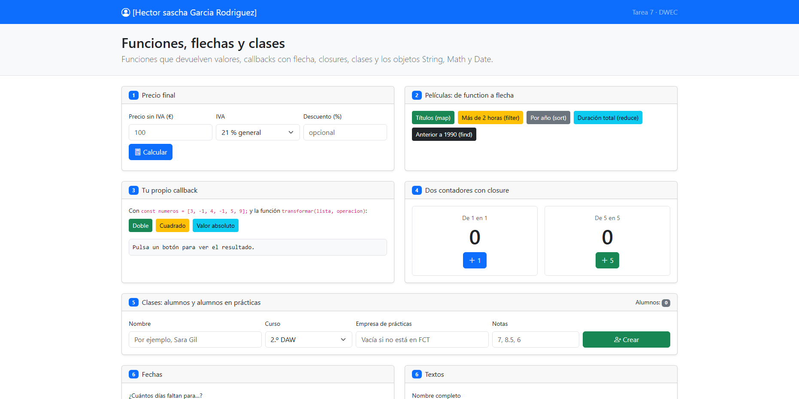
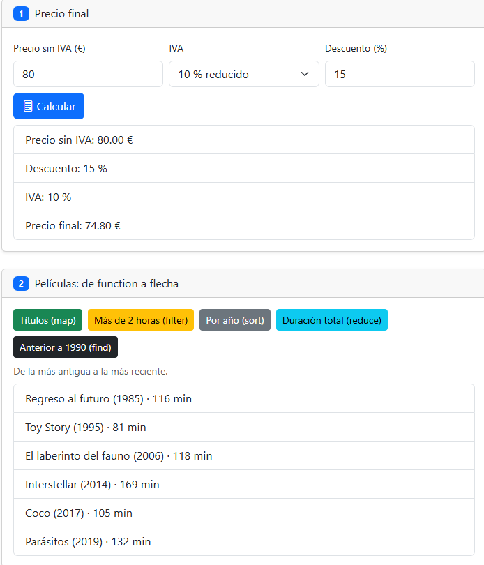
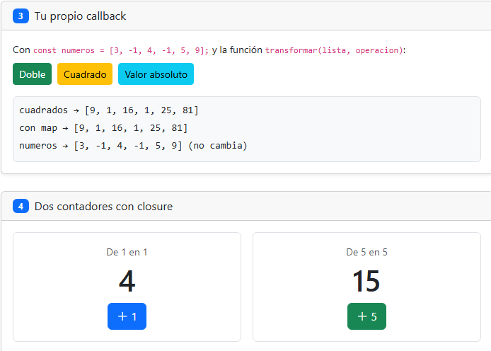
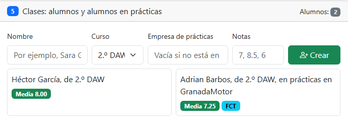

# Tarea 7 · Funciones, flechas y clases

**Autor:** Hector Sascha Garcia Rodriguez · Desarrollo Web en Entorno Cliente (DWEC) · 2.º DAW · Curso 2026-27

En esta carpeta está la página «Funciones, flechas y clases», con seis ejercicios. Todo el JavaScript está en `js/app.js`: las funciones de los botones se escriben con `function`, los callbacks con flecha y las clases con la forma corta de los métodos. Los resultados se pintan con `createElement`, `textContent` y `append`, sin `innerHTML`.

## Capturas

### a) La página recién cargada

Al cargar se ve mi nombre en la navbar, los dos alumnos de partida y los contadores a cero.

### b) Precio con descuento y un botón de las películas

Un producto de 80 € con IVA del 10 % y un 15 % de descuento da 74.80 €. Al lado, las películas ordenadas por año con `sort` sobre una copia.

### c) Mi callback y los contadores

`transformar` da el mismo resultado que `map` y `numeros` no cambia. Los contadores, tras pulsarlos, van por separado: 4 y 15.

### d) Los alumnos

Cuatro alumnos, dos de ellos en prácticas (con la etiqueta FCT), cada uno con su media.

### e) Fechas e iniciales

Los días hasta una fecha, con el nombre del día en español, y las iniciales de un nombre con espacios dobles, que se ignoran gracias al `filter`.

## El closure del ejercicio 4

`crearContador` guarda `cuenta` dentro de la función y devuelve otra función que sigue pudiendo usarla, aunque `crearContador` ya haya terminado. Cada llamada crea su propia `cuenta`, por eso el de 1 en 1 y el de 5 en 5 no se mezclan. Si escribo `cuenta` en la consola da error, porque la variable solo existe dentro del closure.

## Reflexión

Al pasar un callback de `function` a flecha cambia la sintaxis: `peliculas.filter((pelicula) => pelicula.duracion > 120)` hace lo mismo que la versión con `function` y `return`, pero más corta. Si el cuerpo es solo una expresión no hacen falta llaves ni `return`, que se devuelve solo. Si uso llaves, como en `crearContador`, el `return` es obligatorio. Los métodos de una clase, como `media()` de `Alumno`, no se escriben con flecha porque una flecha no tiene su propio `this`, sino el de fuera, y `this.notas` dejaría de apuntar al alumno.

## Fuentes

- MDN, [Funciones flecha](https://developer.mozilla.org/es/docs/Web/JavaScript/Reference/Functions/Arrow_functions)
- MDN, [Closures](https://developer.mozilla.org/es/docs/Web/JavaScript/Guide/Closures)
- MDN, [Clases](https://developer.mozilla.org/es/docs/Web/JavaScript/Reference/Classes)
- MDN, [Date](https://developer.mozilla.org/es/docs/Web/JavaScript/Reference/Global_Objects/Date)
- MDN, [padStart](https://developer.mozilla.org/es/docs/Web/JavaScript/Reference/Global_Objects/String/padStart)

## Uso de IA

He usado Claude (asistente de IA de Anthropic) para organizar los commits, obtener ejemplos de código y preparar el borrador de este README. Después escribí el código en mi proyecto, probé cada botón con la consola abierta, corregí los errores que me salieron y hice yo las capturas.